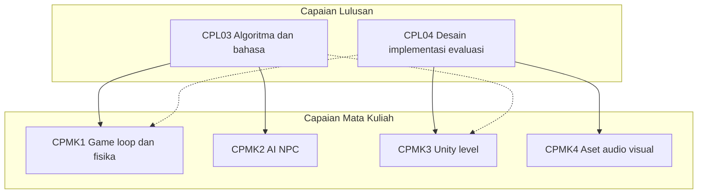
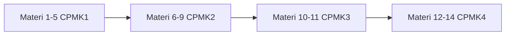

# Pemetaan CPL–CPMK–SUBCPMK dan 14 Materi

**Mata kuliah:** Pengantar Pemrograman Game

Dokumen ini menghubungkan Capaian Pembelajaran Lulusan (CPL) dengan Capaian Pembelajaran Mata Kuliah (CPMK), merumuskan Sub-CPMK, serta menyusun 14 materi pembelajaran. Penyusunan mengikuti pola RPS berbasis OBE di perguruan tinggi Indonesia dan referensi teknis yang sudah dikumpulkan dalam repositori ini.

**Pendekatan teknologi**

| Tahap | Teknologi | CPMK |
|-------|-----------|------|
| Fondasi algoritma | Python 3 + Pygame | CPMK1, CPMK2 |
| Implementasi engine | Unity | CPMK3, CPMK4 |

---

## 1. Capaian Pembelajaran Lulusan (CPL)

| Kode | Rumusan |
|------|---------|
| **CPL03** | Kemampuan merancang dan menganalisis algoritma untuk menyelesaikan permasalahan secara optimal, serta memilih dan menerapkannya pada bahasa pemrograman tertentu. |
| **CPL04** | Kemampuan mendesain, mengimplementasi, dan mengevaluasi solusi berbasis computing yang memenuhi kebutuhan computing pada sebuah disiplin program. |

---

## 2. Capaian Pembelajaran Mata Kuliah (CPMK)

| Kode | Rumusan |
|------|---------|
| **CPMK1** | Merancang *game loop* dan logika fisika sederhana. |
| **CPMK2** | Menerapkan algoritma kecerdasan buatan (AI) dasar untuk NPC. |
| **CPMK3** | Menggunakan game engine (Unity) untuk membangun level. |
| **CPMK4** | Mengintegrasikan aset audio dan visual ke dalam interaksi game. |

---

## 3. Matriks Hubungan CPL–CPMK

| | **CPMK1** Game loop & fisika | **CPMK2** AI NPC | **CPMK3** Engine & level | **CPMK4** Aset audio-visual |
|---|:---:|:---:|:---:|:---:|
| **CPL03** Algoritma & bahasa | **Utama** | **Utama** | Pendukung | Pendukung |
| **CPL04** Desain–implementasi–evaluasi | Pendukung | Pendukung | **Utama** | **Utama** |

### Penjelasan hubungan

- **CPL03 → CPMK1:** Mahasiswa merancang algoritma siklus input–update–render, timestep, gerak, dan collision, lalu menerapkannya dengan Python/Pygame.
- **CPL03 → CPMK2:** Mahasiswa menganalisis dan mengimplementasikan algoritma AI (chase, FSM, A*) pada bahasa Python tanpa bergantung pada fitur *black-box* engine.
- **CPL04 → CPMK3:** Mahasiswa mendesain dan mengimplementasikan solusi level/prototipe pada Unity, lalu mengevaluasi hasilnya.
- **CPL04 → CPMK4:** Mahasiswa mengintegrasikan aset multimedia ke interaksi game dan mengevaluasi kualitas pengalaman audio-visual.
- **CPL04 juga mendukung CPMK1–CPMK2** pada tahap evaluasi prototipe sederhana (playtest, perbaikan bug, refleksi desain).
- **CPL03 juga mendukung CPMK3–CPMK4** ketika mahasiswa memilih dan menyesuaikan algoritma/script C# serta struktur data di dalam engine.

---

## 4. Sub-CPMK

Setiap Sub-CPMK diturunkan dari satu CPMK induk, diberi tingkat Taksonomi Bloom, dan dipetakan ke CPL.

| Kode | Rumusan Sub-CPMK | Bloom | CPMK | CPL |
|------|------------------|-------|------|-----|
| **SUBCPMK1.1** | Menjelaskan struktur *game loop* (input, update, render) dan peran manajemen waktu dalam permainan. | C2 | CPMK1 | CPL03 |
| **SUBCPMK1.2** | Merancang dan mengimplementasikan gerak objek berbasis *delta time* dan vektor pada Pygame. | C3 | CPMK1 | CPL03 |
| **SUBCPMK1.3** | Menerapkan logika fisika sederhana (gravitasi, lompatan, pantulan) dalam simulasi 2D. | C3 | CPMK1 | CPL03 |
| **SUBCPMK1.4** | Mendeteksi dan menangani *collision* menggunakan `Rect` dan/atau *mask* pada sprite. | C4 | CPMK1 | CPL03, CPL04 |
| **SUBCPMK2.1** | Merancang perilaku NPC sederhana (misalnya *chase*) berdasarkan posisi pemain. | C3 | CPMK2 | CPL03 |
| **SUBCPMK2.2** | Mengimplementasikan *Finite State Machine* (idle, patrol, chase, attack/flee) untuk NPC. | C3 | CPMK2 | CPL03 |
| **SUBCPMK2.3** | Menerapkan *pathfinding* berbasis grid dengan algoritma A* untuk navigasi NPC. | C4 | CPMK2 | CPL03 |
| **SUBCPMK2.4** | Mengevaluasi perilaku NPC hasil kombinasi FSM dan A* terhadap skenario permainan. | C5 | CPMK2 | CPL03, CPL04 |
| **SUBCPMK3.1** | Menavigasi antarmuka Unity dan menyusun *project*, *scene*, serta *GameObject* dasar. | C3 | CPMK3 | CPL04 |
| **SUBCPMK3.2** | Membangun level 2D/3D sederhana dengan *collider*, *Rigidbody*, dan kontrol pemain. | C4 | CPMK3 | CPL04 |
| **SUBCPMK4.1** | Mengimpor dan mengonfigurasi aset visual (sprite/model, animasi, UI) ke dalam scene. | C3 | CPMK4 | CPL04 |
| **SUBCPMK4.2** | Mengintegrasikan aset audio dan memicu interaksi audio-visual berdasarkan peristiwa game. | C4 | CPMK4 | CPL04 |
| **SUBCPMK4.3** | Mengevaluasi prototipe game melalui *playtesting* dan memperbaiki integrasi level serta aset. | C5 | CPMK4 | CPL04 |

### Matriks Sub-CPMK terhadap CPMK

| Sub-CPMK | CPMK1 | CPMK2 | CPMK3 | CPMK4 |
|----------|:-----:|:-----:|:-----:|:-----:|
| 1.1–1.4 | X | | | |
| 2.1–2.4 | | X | | |
| 3.1–3.2 | | | X | |
| 4.1–4.3 | | | | X |

---

## 5. Empat Belas Materi Pembelajaran

Materi disusun agar mahasiswa menguasai algoritma di Python/Pygame terlebih dahulu (Materi 1–9), kemudian menerapkan solusi computing pada Unity (Materi 10–14).

### Materi 1 — Pengantar Pemrograman Game dan Setup Python/Pygame

| Aspek | Isi |
|-------|-----|
| **Tujuan** | Memahami ruang lingkup mata kuliah, CPL/CPMK, dan menyiapkan lingkungan pengembangan. |
| **Sub-CPMK** | Pengantar menuju SUBCPMK1.1 |
| **CPL/CPMK** | CPL03; fondasi seluruh CPMK |
| **Ringkasan** | Definisi game sebagai simulasi interaktif *real-time*; peran algoritma dan bahasa; instalasi Python, Pygame, editor; struktur folder proyek. |
| **Praktikum** | Instal Pygame, buat jendela kosong, tampilkan teks/versi Pygame, commit struktur proyek awal. |
| **Referensi** | `referensi_cpl_cpmk.md` (ebook Al Sweigart); panduan Pygame UMA; `referensi_rps_indonesia.md` (ITS, Abdurrab). |

### Materi 2 — Game Loop, Event Handling, dan Clock

| Aspek | Isi |
|-------|-----|
| **Tujuan** | Merancang dan mengimplementasikan *game loop* yang stabil. |
| **Sub-CPMK** | SUBCPMK1.1 |
| **CPL/CPMK** | CPL03, CPMK1 |
| **Ringkasan** | Siklus input → update → render; `pygame.event.get`; `QUIT`; `pygame.time.Clock`; batasan FPS; perbedaan *fixed* vs *variable timestep* (konsep). |
| **Praktikum** | Buat loop penuh: isi warna layar, tangkap event keluar, batasi 60 FPS, tampilkan FPS di judul jendela. |
| **Referensi** | Pygame Quick Start; Game Programming Patterns — Game Loop; Fix Your Timestep!; materi Pygame UDINUS. |

### Materi 3 — Gerak Objek, Vector2, Input, dan Delta Time

| Aspek | Isi |
|-------|-----|
| **Tujuan** | Menggerakkan objek secara independen terhadap frame rate. |
| **Sub-CPMK** | SUBCPMK1.2 |
| **CPL/CPMK** | CPL03, CPMK1 |
| **Ringkasan** | `pygame.Vector2`; posisi dan kecepatan; `key.get_pressed`; `dt = clock.tick(FPS) / 1000`; sinkronisasi `pos` float dengan `rect` integer. |
| **Praktikum** | Karakter digerakkan WASD/panah dengan kecepatan konstan (piksel/detik) pada 30 FPS dan 60 FPS. |
| **Referensi** | Pygame docs; tutorial MoveIt/Chimp; `referensi_cpl_cpmk.md` bagian CPMK1. |

### Materi 4 — Fisika Sederhana: Gravitasi, Lompatan, dan Pantulan

| Aspek | Isi |
|-------|-----|
| **Tujuan** | Menerapkan model fisika dasar dalam update loop. |
| **Sub-CPMK** | SUBCPMK1.3 |
| **CPL/CPMK** | CPL03, CPMK1 |
| **Ringkasan** | Percepatan gravitasi; *jump impulse*; pantulan dinding/lantai; Euler integration sederhana; batasan lantai. |
| **Praktikum** | Prototipe platformer mini: jatuh karena gravitasi, lompat sekali saat di tanah, pantul horizontal. |
| **Referensi** | Numerical Integration (GDC/Box2D); contoh Angry Birds Pygame UDINUS; Polibatam (fisika permainan). |

### Materi 5 — Sprite, Group, dan Collision Detection

| Aspek | Isi |
|-------|-----|
| **Tujuan** | Mendeteksi dan menyelesaikan tabrakan antar objek. |
| **Sub-CPMK** | SUBCPMK1.4 |
| **CPL/CPMK** | CPL03, CPL04, CPMK1 |
| **Ringkasan** | `Sprite` dan `Group`; `spritecollide` / `groupcollide`; AABB dengan `Rect`; pengantar *pixel-perfect* dengan `mask`; resolusi collision sumbu demi sumbu. |
| **Praktikum** | Player mengumpulkan item dan menghindari rintangan; skor bertambah saat tabrakan item. |
| **Referensi** | Pygame sprite & mask docs; makalah collision ITB; workshop Pygame UB. |

### Materi 6 — Pengantar AI NPC dan Perilaku Chase

| Aspek | Isi |
|-------|-----|
| **Tujuan** | Merancang perilaku NPC dasar tanpa pathfinding kompleks. |
| **Sub-CPMK** | SUBCPMK2.1 |
| **CPL/CPMK** | CPL03, CPMK2 |
| **Ringkasan** | Persepsi jarak/arah; normalisasi vektor menuju pemain; batasan kecepatan; perbedaan AI reaktif vs perencanaan. |
| **Praktikum** | NPC mengejar pemain di ruang terbuka; visualisasi garis arah. |
| **Referensi** | Tutorial Game AI Python; Making Games with Python & Pygame; deskripsi AI NPC Univ. Abdurrab. |

### Materi 7 — Finite State Machine untuk NPC

| Aspek | Isi |
|-------|-----|
| **Tujuan** | Mengendalikan perilaku NPC melalui state dan transisi. |
| **Sub-CPMK** | SUBCPMK2.2 |
| **CPL/CPMK** | CPL03, CPMK2 |
| **Ringkasan** | State, event, transition; diagram idle–patrol–chase–attack/flee; implementasi class/fungsi Python; kondisi jarak dan *cooldown*. |
| **Praktikum** | NPC berpatroli antar titik; beralih ke chase bila pemain masuk radius; kembali idle bila keluar jangkauan. |
| **Referensi** | Slide FSM Game AI; artikel A*+FSM ITN Malang; skripsi FSM UIN Malang. |

### Materi 8 — Pathfinding Grid: dari BFS/Dijkstra ke A*

| Aspek | Isi |
|-------|-----|
| **Tujuan** | Menganalisis dan menerapkan pencarian jalur optimal pada peta berhalangan. |
| **Sub-CPMK** | SUBCPMK2.3 |
| **CPL/CPMK** | CPL03, CPMK2 |
| **Ringkasan** | Representasi grid/graf; biaya `g`, heuristik `h`, `f = g + h`; Manhattan/Euclidean; `heapq`; rekonstruksi jalur. |
| **Praktikum** | Visualisasi A* pada grid Pygame: tandai start, goal, dinding; animasikan jalur. |
| **Referensi** | Slide A* ITB (Rinaldi Munir); Game AI Pathfinding PDF; Eli Bendersky Pygame A*; makalah pathfinding ITB. |

### Materi 9 — Integrasi FSM dan A* (Mini Proyek AI)

| Aspek | Isi |
|-------|-----|
| **Tujuan** | Mengevaluasi NPC yang menggabungkan pengambilan keputusan dan navigasi. |
| **Sub-CPMK** | SUBCPMK2.4 (menguatkan 2.2–2.3) |
| **CPL/CPMK** | CPL03, CPL04, CPMK2 |
| **Ringkasan** | FSM memanggil A* saat state chase; *repath* berkala; batasan performa; skenario uji (labirin, rintangan dinamis sederhana). |
| **Praktikum** | Mini game: pemain bersembunyi/menghindar; NPC patrol → chase dengan A*; laporan singkat hasil playtest. |
| **Referensi** | Studi kasus ITN, UMRI (A* + behaviour); `referensi_perguruan_tinggi_indonesia.md` bagian CPMK2. |

### Materi 10 — Pengenalan Unity: Project, Scene, dan GameObject

| Aspek | Isi |
|-------|-----|
| **Tujuan** | Menguasai lingkungan game engine untuk implementasi solusi computing. |
| **Sub-CPMK** | SUBCPMK3.1 |
| **CPL/CPMK** | CPL04, CPMK3 |
| **Ringkasan** | Unity Hub/Editor; hierarchy, inspector, project window; scene; GameObject dan komponen; perbandingan konsep dengan Pygame. |
| **Praktikum** | Instal Unity LTS; buat project 2D; susun scene kosong dengan kamera dan objek primitif; simpan scene. |
| **Referensi** | Unity Learn; RPS ITS Desain dan Pemrograman Game; RPS UNIMA Pengembangan Game; pelatihan Unity STKIP Rokania. |

### Materi 11 — Membangun Level, Physics, dan Kontrol Pemain

| Aspek | Isi |
|-------|-----|
| **Tujuan** | Membangun level playable dengan sistem fisika engine. |
| **Sub-CPMK** | SUBCPMK3.2 |
| **CPL/CPMK** | CPL04, CPMK3 |
| **Ringkasan** | Tilemap/greyboxing; Collider2D/3D; Rigidbody; script gerak (`Update`/`FixedUpdate`); trigger volume; desain jalur pemain. |
| **Praktikum** | Level platformer/top-down sederhana: lantai, rintangan, player bergerak dan bertabrakan dengan environment. |
| **Referensi** | Unity Introduction to Level Design (ebook); Junior Programmer Create with Code; kurikulum Polibatam; UMS Praktikum Pemrograman Game. |

### Materi 12 — Import Aset Visual, Animasi, dan UI Dasar

| Aspek | Isi |
|-------|-----|
| **Tujuan** | Mengintegrasikan aset visual ke level yang sudah dibangun. |
| **Sub-CPMK** | SUBCPMK4.1 |
| **CPL/CPMK** | CPL04, CPMK4 |
| **Ringkasan** | Pipeline import Unity; sprite sheet/Animator; Canvas UI (skor, nyawa); penggantian placeholder greybox dengan aset. |
| **Praktikum** | Import sprite/karakter; animasi idle/run; tampilkan skor di UI; bandingkan scene sebelum/sesudah aset. |
| **Referensi** | Unity Asset Importing Manual; studi kasus UNY KATELU; UNTAN GEBI; STKIP Rokania (insersi aset). |

### Materi 13 — Integrasi Audio dan Trigger Interaksi

| Aspek | Isi |
|-------|-----|
| **Tujuan** | Menghubungkan peristiwa gameplay dengan umpan balik audio-visual. |
| **Sub-CPMK** | SUBCPMK4.2 |
| **CPL/CPMK** | CPL04, CPMK4 |
| **Ringkasan** | AudioClip, AudioSource; BGM vs SFX; trigger saat pickup, tabrakan, menang/kalah; particle sederhana (opsional). |
| **Praktikum** | Tambah BGM looping; SFX saat lompat/ambil item/game over; uji volume dan timing. |
| **Referensi** | Unity audio docs; Godot audio docs (pembanding konsep); UNDIP media pembelajaran Unity; materi interaktivitas UNIMA minggu terkait efek. |

### Materi 14 — Evaluasi Prototipe, Playtesting, dan Presentasi

| Aspek | Isi |
|-------|-----|
| **Tujuan** | Mengevaluasi solusi computing secara menyeluruh dan menyajikan hasil. |
| **Sub-CPMK** | SUBCPMK4.3 (merefleksikan seluruh CPMK) |
| **CPL/CPMK** | CPL04 (utama), CPL03 (refleksi algoritma); CPMK1–CPMK4 |
| **Ringkasan** | Checklist fungsional; playtest antar kelompok; log bug; kesesuaian GDD/ringkasan desain dengan build; presentasi demo; refleksi pilihan Python vs Unity. |
| **Praktikum** | Finalisasi build Unity; lembar evaluasi; presentasi 5–10 menit; laporan singkat perbaikan. |
| **Referensi** | RPS UNIMA (pengujian & presentasi); RPS ITS (diskusi akhir); praktik QA pada studi kasus UNDIP/UNTAN. |

---

## 6. Ringkasan Distribusi Materi

| Materi | Judul singkat | Sub-CPMK utama | Teknologi |
|--------|---------------|----------------|-----------|
| 1 | Setup & pengantar | menuju 1.1 | Python/Pygame |
| 2 | Game loop & Clock | 1.1 | Python/Pygame |
| 3 | Gerak & delta time | 1.2 | Python/Pygame |
| 4 | Fisika sederhana | 1.3 | Python/Pygame |
| 5 | Collision & sprite | 1.4 | Python/Pygame |
| 6 | AI chase | 2.1 | Python/Pygame |
| 7 | FSM NPC | 2.2 | Python/Pygame |
| 8 | Pathfinding A* | 2.3 | Python/Pygame |
| 9 | Mini proyek FSM+A* | 2.4 | Python/Pygame |
| 10 | Pengenalan Unity | 3.1 | Unity |
| 11 | Bangun level & physics | 3.2 | Unity |
| 12 | Aset visual & UI | 4.1 | Unity |
| 13 | Audio & interaksi | 4.2 | Unity |
| 14 | Evaluasi & presentasi | 4.3 | Unity (+ refleksi Pygame) |

---

## 7. Catatan Penggunaan

- Dokumen ini dapat menjadi dasar penyusunan RPS lengkap (indikator, asesmen, bobot, dan alokasi waktu TM/BT/BM).
- UTS/UAS dapat ditempatkan setelah Materi 9 (asesmen CPMK1–CPMK2) dan setelah Materi 14 (asesmen CPMK3–CPMK4), sesuai kebijakan program studi.
- Referensi detail tautan tersedia di `referensi_cpl_cpmk.md`, `referensi_rps_indonesia.md`, dan `referensi_perguruan_tinggi_indonesia.md`.

*Disusun berdasarkan `cpl_cpmk.text` dan referensi repositori; terakhir disusun: 18 September 2026.*
